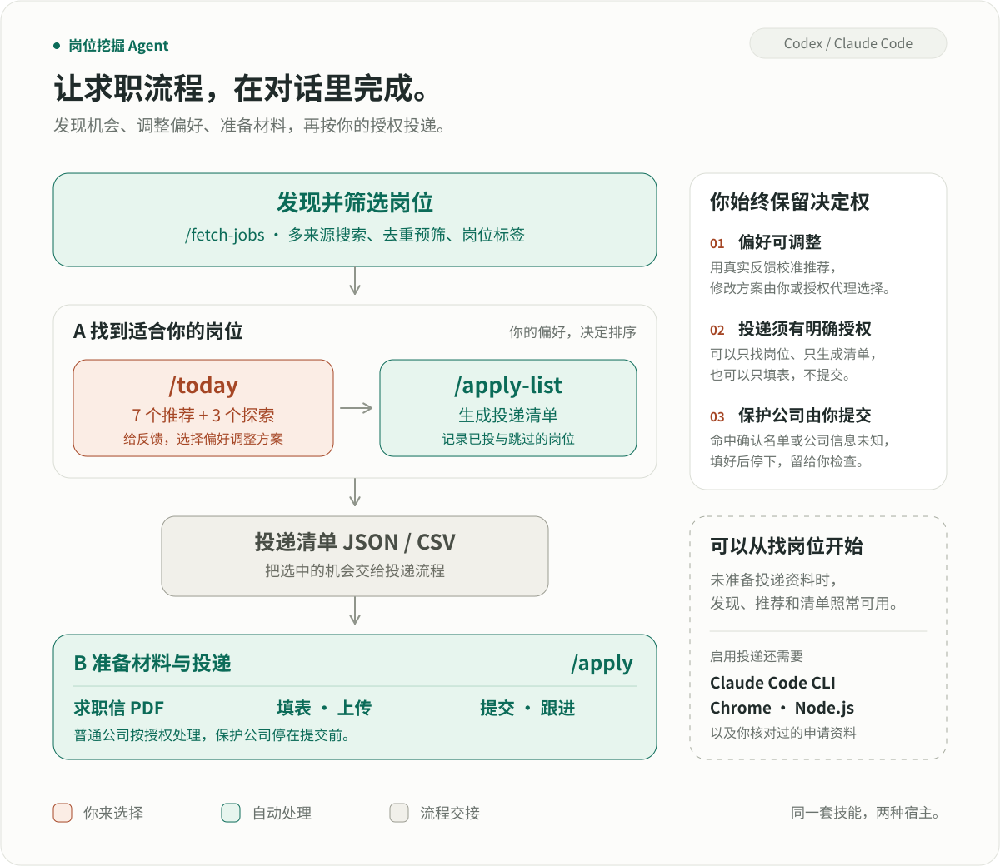

<div align="center">

<h1>岗位挖掘 Agent</h1>

<p><strong>找到适合你的机会，把求职流程交给助手。</strong></p>
<p>在 Codex 或 Claude Code 中，完成岗位发现、推荐反馈、材料准备与授权投递。</p>

<p>
  <a href="#快速开始">快速开始</a> ·
  <a href="#日常命令">日常命令</a> ·
  <a href="#投递如何执行">投递规则</a> ·
  <a href="docs/usage.md">完整使用指南</a>
</p>

</div>



**每日推荐帮助你发现机会、校准偏好；投递清单汇集符合条件的待投岗位，不限于今日推荐。** 你可以只浏览、只反馈、只导出清单，也可以在准备好资料后委托助手投递。

支持多个招聘来源与岗位 JSON 导入，包括 Indeed、LinkedIn、Glassdoor、ZipRecruiter、Google Jobs，以及可选的 Workday、Greenhouse、Lever、Ashby、Avature 等站点。来源可用性取决于网站、地区与访问条件。[查看来源配置 →](docs/usage.md#岗位从哪里来)

## 快速开始

### 1. 下载并安装

需要 Git、[uv](https://docs.astral.sh/uv/getting-started/installation/)，以及已登录、可用的 **Codex 或 Claude Code**。项目使用 Python 3.13，uv 可按项目要求安装所需版本。

```sh
git clone https://github.com/WItaZhang/codex-job-agent.git
cd codex-job-agent
uv sync --locked
```

需要打开网页补全岗位原文时，再安装浏览器：

```sh
uv run playwright install chromium
```

### 2. 打开项目，检查连接

选择你使用的宿主，在刚下载的仓库目录中开始会话：

- **Codex**：打开这个仓库；使用 CLI 时，在仓库目录运行 `codex`。
- **Claude Code**：在仓库目录运行 `claude`。

仓库已提供接入配置：Codex 使用 `.codex/config.toml`，Claude Code 使用 `.mcp.json`。按宿主提示完成项目配置的审阅与必要批准。随后对助手说：

> 请阅读这个项目的使用说明，检查 intent-agent 工具是否已连接。先不要抓取或投递；如果连接失败，请指出具体原因。

**能打开仓库不等于工具已连接。** 让助手确认能够调用项目的只读工具（例如 `get_discovery_setup`，尚未配置时应返回缺项信息）；未连接时先排查，不继续初始化。有关依赖、路径等问题见[启动故障](docs/usage.md#启动故障)。

### 3. 告诉助手你要找什么

不需要先掌握 YAML。工具连接正常后，可以先用自己的话描述需求，例如：

> 我第一次使用。想找美国的机器学习工程师岗位，优先远程，不考虑实习。请按项目的配置示例帮我整理求职偏好和搜索设置；缺少的信息问我，不要直接沿用示例里的个人偏好。先展示摘要，不抓取、不投递。

把示例里的岗位、地区和要求换成你自己的。助手需要整理两份本地配置：

| 文件 | 内容 | 用途 |
| --- | --- | --- |
| `data/local/intent.yaml` | 目标岗位、地点、工作方式等偏好与排除条件；薪资下限可不设 | 决定筛选与排序 |
| `data/local/searches.yaml` | 搜索关键词、地区、招聘来源与过滤条件 | 决定从哪里找、搜什么 |

核对助手展示的摘要，特别是目标地区、远程要求和排除条件。确认无误后说：

> 配置摘要符合我的要求，请保存配置并初始化意图，检查搜索设置。完成后告诉我结果，暂不抓取或投递。

这是让宿主助手协助准备配置，再调用项目现有初始化工具；项目目前没有独立的新手设置向导。熟悉配置的用户也可以直接参考[意图示例](docs/examples/intent.example.yaml)和[搜索示例](docs/examples/searches.example.yaml)自行填写。

**初始化成功后，才开始下面的日常流程。** 初始化只做一次；之后通过反馈或明确的修改指令调整已存偏好，不能靠反复编辑初始文件更新。

<details>
<summary>可选：用合成岗位体验，不访问招聘网站</summary>

完成初始化后，让助手导入 [合成岗位示例](docs/examples/jobs.example.json)，只使用这些示例打标签和生成推荐，并明确要求不要抓取。示例与个人偏好不匹配时，推荐可能不足。该过程仍会使用宿主模型额度，不是完全离线运行。

</details>

## 日常怎么用

### 看机会，按需反馈

初始化后，使用 `$today` 或 `/today` 查看今天的推荐。当天尚未抓取时，助手会先运行岗位发现，完成预筛与标签处理。默认展示 **7 个推荐 + 3 个探索**，数量可配置，合适岗位不足时按实际数量展示。

可以只看不反馈，也可以一行回复：

> `1+ 2-坐班 3- 5+ 6?地点不对`

`+` 表示想投，`-` 表示不想投，`?` 表示岗位信息读错；没提到的岗位不作为反馈。助手分析偏好不匹配的原因，展示调整方案，由你或已授权代理选择。信息读错只修正岗位标签，不改变偏好。偏好变化用于后续排序与清单生成。

只想更新岗位库时，单独使用 `$fetch-jobs` 或 `/fetch-jobs`，不必当场查看推荐或反馈。

### 需要投递时，再整理清单

使用 `$apply-list` 或 `/apply-list`，按当前偏好生成待投清单：包含符合推荐条件或标记想投的岗位，按拒绝反馈、岗位去重和投递状态等规则过滤，已投与已跳过岗位不再列入。**无需先完成当天反馈，清单也不只包含今天推荐的岗位。**

- **自行投递**：导出 JSON / CSV，投完告诉助手“1–5 已投，7 跳过”，更新状态。
- **委托助手**：先按下方指南配置申请资料并明确投递范围，再使用 `$apply` 或 `/apply`。它会自动生成当前清单，无需先手动运行清单命令。

## 日常命令

以下是按目的选择的入口，不是必须依次执行的步骤。

| 你想做什么 | Codex | Claude Code | 得到什么 |
| --- | --- | --- | --- |
| 找今天的岗位 | `$fetch-jobs` | `/fetch-jobs` | 抓取、筛选并打标签的岗位 |
| 查看适合自己的机会 | `$today` | `/today` | 默认 7 个推荐 + 3 个探索，可选择反馈；按需先抓取 |
| 整理准备投递的岗位 | `$apply-list` | `/apply-list` | JSON / CSV 清单，记录已投和跳过 |
| 准备材料并投递 | `$apply` | `/apply` | 自动生成清单，准备求职信、填表并按授权处理 |

也可以直接说：“导入 `data/local/jobs.json`”“1–5 已投，7 跳过”或“停下投递”。

## 投递如何执行

投递是可选功能。**即使在 Codex 中使用，当前投递后端也需要 Claude Code CLI、Google Chrome 和 Node.js。** 按[投递配置指南](docs/usage.md#投递)准备简历、个人资料、标准答案和提交前确认的公司名单。


- **你的确认名单始终有效**：缺少名单不能开始投递；重试与恢复也不会绕过保护。
- **遇到登录、验证码等门槛会停下**，留给你处理，不破解验证码。
- **不会填写 SSN、银行卡或支付申请费**，遇到仲裁协议也会停下。
- **可以要求停止**；已经进入自动提交的岗位会完成当前提交后再停，避免结果不明。

浏览器使用项目专属 profile，不复制日常 Chrome 资料。自动提交无法撤回，请先核对申请资料和授权范围。

## 数据、费用与当前支持

个人文件放在被 Git 忽略的 `data/local/`。岗位、偏好及反馈会按功能交给模型处理；投递时，必要的申请资料会交给投递模型和招聘网站。**不要把密钥贴进对话。** 详细说明见[数据去向、下载与费用](docs/usage.md#数据去向下载与费用)。

宿主订阅或 API 费用由你承担；可选模型服务和投递后端也可能产生费用。部分岗位来源无需额外模型 key，网站限流或改版仍可能影响抓取。

| 环境或能力 | 当前状态 |
| --- | --- |
| macOS arm64 | 已验证双宿主接入、技能与子 agent、合成推荐及投递授权流程 |
| Linux | CI 覆盖测试、浏览器及包检查；桌面宿主和投递安装未全面验证 |
| Windows | 暂未验证，不承诺可用 |
| 真实招聘网站投递效果 | 随网站与账户环境变化；合成测试不代表真实投递成功率 |

## 文档与开发

- [完整使用与配置指南](docs/usage.md)：来源配置、申请资料、恢复、升级与故障处理。
- [产品规格](spec.md) · [开发约定](CLAUDE.md) · [交付验证记录](specs/github-host-release.review.md)。
- 许可证：**AGPL-3.0-only**。岗位发现与投递复用 [ApplyPilot](https://github.com/Pickle-Pixel/ApplyPilot)，来源说明见 [NOTICE.md](NOTICE.md)。
