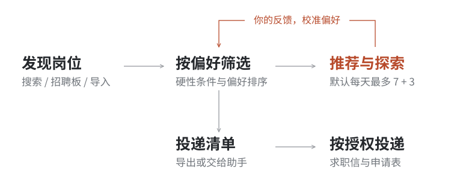

# 岗位挖掘 Agent

在 Codex 或 Claude Code 里找岗位，用你的反馈调整下一轮推荐。

项目将求职偏好保存为明确的筛选规则：想做什么、去哪里、哪些条件可以商量。每天给你一组岗位，你说想投、不想投，或哪里读错了；助手据此提出修改，记录每次选择的依据。合适的岗位可以导出为投递清单，也可以交给助手准备材料和填写申请。



## 反馈怎样改变推荐

默认每天最多展示 7 个推荐岗位和 3 个探索岗位。推荐取当前排序靠前的岗位，探索让你有机会重新考虑原先不太偏好的方向；两者都遵守硬性条件。

看完后可以这样回复：

```text
1+ 2-需要坐班 3?地点读错了
```

这表示想投第 1 个、不想投第 2 个，第 3 个的地点信息需要核对。没回复的岗位不算反馈，也可以只浏览。

反馈与当前偏好不一致时，助手会指出要改哪条规则、为什么改，以及这会影响哪些历史判断。你选择方案，或明确授权助手依据已有反馈选择后，修改才生效。岗位信息读错时只修正标签，不改变求职偏好。

## 快速开始

需要 Git、[uv](https://docs.astral.sh/uv/getting-started/installation/)，以及可正常使用的 Codex 或 Claude Code。项目使用 Python 3.13+，uv 可以管理 Python 和依赖。

```sh
git clone https://github.com/WItaZhang/codex-job-agent.git
cd codex-job-agent
uv sync --locked
uv run playwright install chromium
```

在 Codex 中打开仓库，或在仓库目录运行 `codex` / `claude`，按提示审阅项目配置并批准工具连接。第一次使用时告诉助手：

> 帮我初始化求职设置。我想找 [岗位方向]，地点是 [国家或城市]，工作方式是 [远程、混合或现场]，其他要求是 [你的条件]。先检查工具连接，再根据这些要求整理偏好和搜索配置；缺信息问我，等我核对后初始化。先不投递。

初始化完成后，运行 `$today`（Codex）或 `/today`（Claude Code）。配置文件格式和连接问题见[首次设置指南](docs/usage.md#首次设置)。

## 常用命令

| 命令 | 用途 |
| --- | --- |
| `fetch-jobs` | 抓取或更新岗位，去重、筛选并打标签 |
| `today` | 查看推荐与探索岗位，处理反馈；当天没抓取时会先抓取 |
| `apply-list` | 生成 JSON / CSV 投递清单，记录已投和跳过的岗位 |
| `apply` | 准备求职信、填写申请，并在授权范围内投递 |

Codex 使用 `$命令`，Claude Code 使用 `/命令`。例如 `$apply-list` 或 `/apply-list`。

投递清单从岗位库按当前偏好、反馈和投递状态生成，不限于当天推荐的岗位。自己投完后，可以告诉助手「1–5 已投，7 跳过」。直接运行 `apply` 也会生成清单。

## 交给助手投递

先准备简历、个人资料、标准答案和需要「提交前确认」的公司名单，配置方式见[投递指南](docs/usage.md#投递)。投递后端依赖 Claude Code CLI、Google Chrome 和 Node.js，即使前台用的是 Codex。

你可以要求「只填不交」，也可以明确授权自动投递指定清单。确认名单中的公司和公司信息未知的岗位只填到提交前，由你检查并亲自提交。自动提交无法撤回。

登录或验证码需要你处理时，助手会记录待办；解决后可以继续。可以随时要求停止，已进入自动提交的岗位会先完成当前提交。仲裁协议、SSN、支付信息和明确禁止 AI 作答的筛选题都会让助手停下。

## 数据与运行环境

个人配置、简历和历史保存在本地 `data/local/`，该目录已被 Git 忽略。模型仍会接收完成任务所需的岗位、偏好或申请资料；投递时招聘网站也会收到申请资料。宿主订阅和可选模型 API 的费用由使用者承担。详见[数据去向与费用](docs/usage.md#数据去向下载与费用)。

岗位发现支持 JobSpy、Workday 和可选公司招聘板，也可导入岗位 JSON。各网站的可用性取决于地区、访问限制和页面变化。[配置岗位来源](docs/usage.md#岗位从哪里来)

macOS arm64 已验证双宿主接入与合成流程；Linux 有 CI 覆盖，桌面投递未全面验证；Windows 未验证。合成测试不代表真实网站投递效果。[版本与验证范围](docs/usage.md#支持与验证范围)

## 实现与开发

Python 处理领域逻辑，SQLite 保存岗位、偏好版本和操作记录，通过 MCP 向两个宿主提供工具。模型负责理解文本；[打分](src/intent_job_agent/scoring.py)、[每日选择](src/intent_job_agent/selection.py)和[历史回放](src/intent_job_agent/replay.py)由确定性代码完成。简历背景不参与偏好打分。

使用细节见[使用指南](docs/usage.md)，需求见[产品规格](spec.md)。参与开发前请阅读[开发约定](CLAUDE.md)。

采用 AGPL-3.0-only 许可证。岗位发现与投递复用 [ApplyPilot](https://github.com/Pickle-Pixel/ApplyPilot)，来源说明见 [NOTICE.md](NOTICE.md)。
