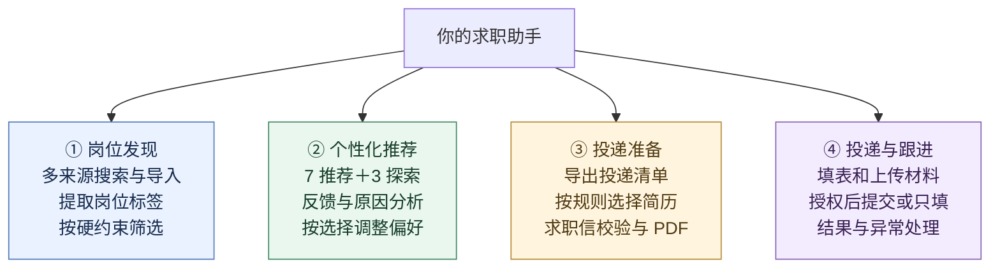
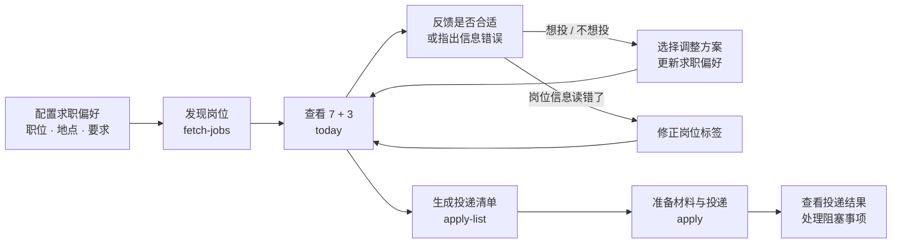
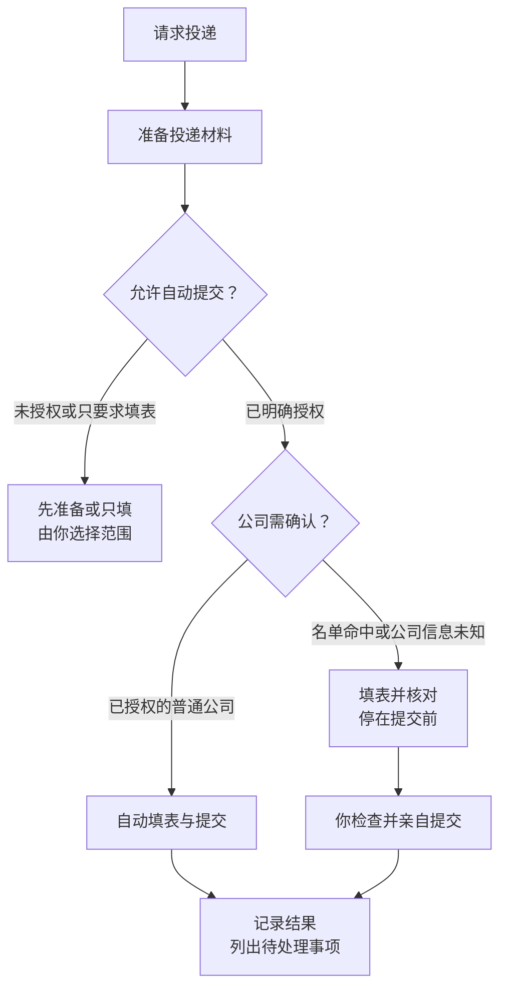

# 岗位挖掘 Agent

**在 Codex 或 Claude Code 里，从找岗位、筛选推荐，到准备材料和投递。**

告诉它你想找什么工作，每天查看 **7 个推荐岗位 + 3 个探索岗位**。用一句话反馈哪些合适、哪些不合适，逐步调整求职偏好，再把选中的岗位整理成清单、准备求职信并按你的授权投递。

适合已经使用 Codex 或 Claude Code、愿意在本机配置求职资料的用户。

[快速开始](#快速开始) · [日常命令](#日常命令) · [投递规则](#投递如何执行) · [完整使用指南](docs/usage.md)

## 产品能做什么



岗位来源包括 Indeed、LinkedIn、Glassdoor、ZipRecruiter、Google Jobs，以及可选的 Workday、Greenhouse、Lever、Ashby、Avature 等招聘站点。也可以导入自己的岗位 JSON。各来源的可用性取决于网站、地区和访问条件，详见[来源配置](docs/usage.md#岗位从哪里来)。

## 一次完整的使用流程



你可以只使用找岗位、推荐和清单功能；准备好投递资料后，再启用投递。

**对话示例（示意）：**

> **你：** 我想找美国的机器学习工程师岗位，优先远程。先帮我找岗位，不投递。
>
> **你：** 查看今天的推荐。
>
> **你：** `1+ 2-坐班 3- 5+ 6?地点不对`
>
> **助手：** 根据反馈分析原因，给出调整选项。
>
> **你：** 选择合适的方案，然后生成投递清单。

`+` 表示想投，`-` 表示不想投，`?` 表示岗位信息读错了。未反馈的岗位不会被当作偏好信号。

## 快速开始

### 1. 下载并安装

需要 Git、[uv](https://docs.astral.sh/uv/getting-started/installation/)，以及已登录、可用的 **Codex 或 Claude Code**。项目使用 Python 3.13，uv 可按项目要求安装所需版本。

```sh
git clone https://github.com/WItaZhang/codex-job-agent.git
cd codex-job-agent
uv sync --locked
mkdir -p data/local
cp docs/examples/intent.example.yaml data/local/intent.yaml
cp docs/examples/searches.example.yaml data/local/searches.yaml
```

编辑这两个文件，填入自己的求职偏好、搜索关键词和地点。需要打开网页补全岗位原文时，再安装浏览器：

```sh
uv run playwright install chromium
```

### 2. 选择你的宿主

始终从仓库根目录启动。先审阅并信任项目指令和权限配置；工具可用不代表你已经授权自动投递。

| | Codex | Claude Code |
| --- | --- | --- |
| 启动 | 在 Codex 中打开本仓库，或运行 `codex` | 在仓库根目录运行 `claude` |
| 接入 | 信任项目后加载 `.codex/config.toml` | 信任项目，并批准 `intent-agent` MCP 服务 |
| 每日推荐 | `$today` | `/today` |
| 其他入口 | 使用 `$` 前缀 | 使用 `/` 前缀 |

两个宿主共用同一套技能与数据。如果没有看到技能，重启宿主；其他问题见[启动故障](docs/usage.md#启动故障)。

### 3. 初始化并查看推荐

在对话里发送：

> 我已核对 `data/local/intent.yaml` 和 `data/local/searches.yaml`。请初始化意图并检查搜索设置。本次只允许发现、打标签和推荐，不投递。

然后使用 `$today` 或 `/today`。当天还没有抓取岗位时，它会先运行岗位发现。

想先体验离线流程，可以复制[合成岗位示例](docs/examples/jobs.example.json)到 `data/local/jobs.json`，明确告诉助手“只使用示例岗位，不运行抓取”，让它导入、打标签并生成推荐。宿主模型仍会消耗额度。

## 日常命令

| 你想做什么 | Codex | Claude Code | 得到什么 |
| --- | --- | --- | --- |
| 找今天的岗位 | `$fetch-jobs` | `/fetch-jobs` | 抓取、筛选并打标签的岗位 |
| 查看适合自己的机会 | `$today` | `/today` | 7 个推荐 + 3 个探索，以及反馈调整流程 |
| 整理准备投递的岗位 | `$apply-list` | `/apply-list` | JSON / CSV 清单，记录已投和跳过 |
| 准备材料并投递 | `$apply` | `/apply` | 求职信、填表结果和投递状态 |

也可以直接说：“导入 `data/local/jobs.json`”“1–5 已投，7 跳过”或“停下投递”。

## 投递如何执行

投递是可选功能。**即使在 Codex 中使用，当前投递后端也需要 Claude Code CLI、Google Chrome 和 Node.js。** 按[投递配置指南](docs/usage.md#投递)准备简历、个人资料、标准答案和提交前确认的公司名单。



- **你的确认名单始终有效**：缺少名单不能开始投递；重试与恢复也不会绕过保护。
- **遇到登录、验证码等门槛会停下**，留给你处理，不破解验证码。
- **不会填写 SSN、银行卡或支付申请费**，遇到仲裁协议也会停下。
- **可以要求停止**；已经进入自动提交的岗位会完成当前提交后再停，避免结果不明。

浏览器使用项目专属 profile，不复制日常 Chrome 资料。自动提交无法撤回，请先核对申请资料和授权范围。

## 数据、费用与当前支持

个人文件放在被 Git 忽略的 `data/local/`。岗位、偏好及反馈会按功能交给模型处理；投递时，必要的申请资料会交给投递模型和招聘网站。**不要把密钥贴进对话。** 详细说明见[数据去向、下载与费用](docs/usage.md#数据去向下载与费用)。

宿主订阅或 API 费用由你承担；可选模型服务和投递后端也可能产生费用。部分岗位来源无需额外模型 key，网站限流或改版仍可能影响抓取。

| 环境或能力 | 当前状态 |
| --- | --- |
| macOS arm64 | 已验证双宿主接入、技能与子 agent、合成推荐及投递授权流程 |
| Linux | CI 覆盖测试、浏览器及包检查；桌面宿主和投递安装未全面验证 |
| Windows | 暂未验证，不承诺可用 |
| 真实招聘网站投递效果 | 随网站与账户环境变化；合成测试不代表真实投递成功率 |

## 文档与开发

- [完整使用与配置指南](docs/usage.md)：来源配置、申请资料、恢复、升级与故障处理。
- [产品规格](spec.md) · [开发约定](CLAUDE.md) · [交付验证记录](specs/github-host-release.review.md)。
- 许可证：**AGPL-3.0-only**。岗位发现与投递复用 [ApplyPilot](https://github.com/Pickle-Pixel/ApplyPilot)，来源说明见 [NOTICE.md](NOTICE.md)。
